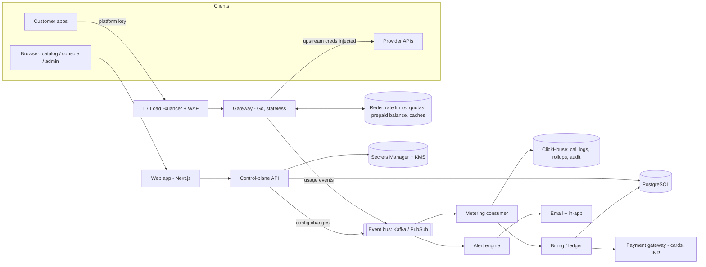
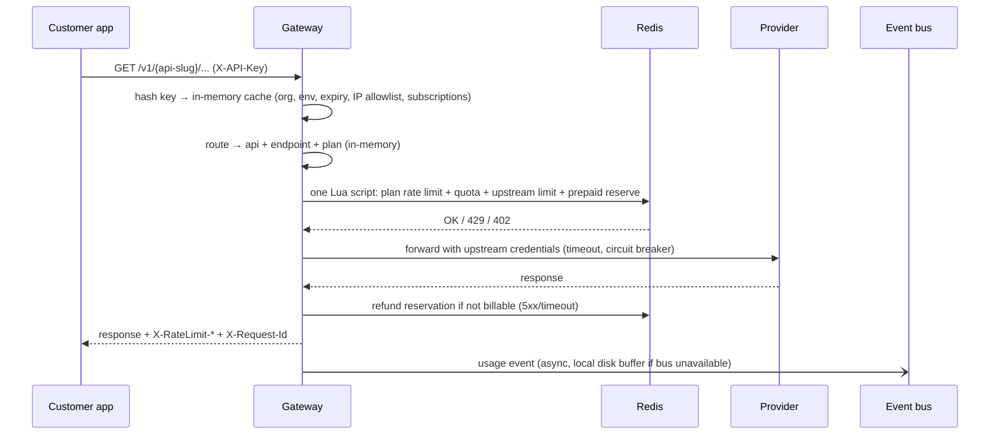

# API Marketplace — MVP Architecture & Data Model (v0.5)

_Companion to `mvp-requirements.md`. Phase 1 = REST only, India only, INR, card only. Webhooks and gRPC are Phase 2. Costs are in `aws-cost-estimate.md`; a cheaper staged path (local Mac → lean servers → full HA) is in §11._

## 0. Sizing targets (confirmed for Phase 1)
- ~500 APIs at launch → ~2,000.
- **Launch peak ~2,000 RPS** through the gateway, average ~500 RPS (≈ 40M calls/day). Designed to scale horizontally to ~50,000 RPS without redesign. Revisit once real traffic data exists.
- Gateway overhead target: p99 < 30 ms in-region (requirement: < 100 ms).
- Availability target 99.99% for the full deployment (Stage 2, §8) → multi-zone active-active in one region + warm standby in a second Indian region. The lean Stage 1 deployment (§11) offers less (~99.5–99.9%).

## 1. System overview



**Two planes:**
- **Data plane** (hot path, must be 99.99%): load balancer, gateway, Redis, event bus. It keeps working for a while even if the control plane is down, because it runs from caches.
- **Control plane** (99.9% is acceptable): web app, control-plane API, PostgreSQL, billing, onboarding, alerting.

## 2. Components

| Component | Responsibility | Suggested tech |
|---|---|---|
| **Gateway** | Key auth, routing, subscription check, rate limit/quota/balance, credential injection, retries, circuit breaking, metering events | Custom Go service on **Gin** (REST-only in Phase 1, billing logic is custom anyway, no extra hops). Alternative: Kong/APISIX with plugins. |
| **Web app** | Public catalog (SSR/SEO), customer console, internal admin console | Next.js |
| **Control-plane API** | Identity, orgs, keys, catalog, onboarding workflow, plans, subscriptions, alerts config | Go on **Gin**, modular monolith in Phase 1 (layered: transport → service → ports → adapters), split later |
| **Onboarding pipeline** | Spec ingestion (OpenAPI 2/3), draft listing, mock server, snippet generation (Go/Node/Java) | openapi parser, Prism-style mock, templated snippets |
| **Metering consumer** | Event bus → ClickHouse logs + per-minute rollups; → ledger | Go consumer |
| **Billing / ledger** | Prepaid wallet, postpaid invoicing, GST invoices, provider statements, PSP integration | Go service, double-entry ledger in PostgreSQL |
| **Alert engine** | Evaluate quota/budget/balance/error/status rules every few seconds | Go consumer on rollups |
| **Notifications** | Email + in-app (SSE/WebSocket) only in Phase 1 | Transactional email provider + Postgres `notifications` |
| **Audit** | Append-only audit events from all services | Event bus → ClickHouse (60-day TTL) |
| _Webhook relay (Phase 2)_ | _Per-subscription inbound URLs, verify provider signature, meter, re-sign (HMAC), deliver with retries + DLQ; platform events by webhook_ | _Go service + a queue_ |

**Code structure (decided 2026-11-04): Gin for HTTP, interfaces at every boundary.**
- `internal/domain`: entities and business rules (orgs, keys, plans, ledger, money, GSTIN). No I/O, no framework.
- `internal/service`: control-plane use cases. Each service depends only on small interfaces it declares (`OrgRepo`, `KeyRepo`, `LedgerRepo`, `BalanceStore`, `TxManager`, `Clock`, `KeyGenerator`…), so it is unit-tested with in-memory fakes.
- `internal/adapter/{postgres,redis,clickhouse,secrets,spool}`: implementations of those interfaces; tested against real Postgres/Redis.
- `internal/transport/http`: Gin routers and handlers. They decode, call a service through an interface, and encode; no SQL or business rules.
- `internal/gateway`: the proxy, on Gin, depending only on its own ports (`CatalogView`, `Limiter`, `UsagePublisher`, `Breakers`).
- `cmd/*`: wiring only. Constructor injection, no DI framework.

**Modular monolith for the control plane:** with a small MVP team, one deployable with clear modules (identity, catalog, billing...) is much cheaper to run than ten microservices. The gateway and consumers are separate because they scale and fail differently.

## 3. Gateway hot path



Key points:
- **One Redis round-trip per call** (~1 ms). All checks are done atomically in a single Lua script: plan token bucket, period quota counter, global upstream bucket for the provider, and (prepaid only) reserving the call's price from the balance.
- **Config in memory:** keys, subscriptions, routes and plans are cached in each gateway pod and refreshed by change events from the control plane (plus a TTL as a safety net). Revoking a key takes effect within seconds.
- **Upstream credentials:** decrypted secrets cached in memory; a background worker refreshes OAuth tokens before expiry.
- **Retries:** idempotent methods only, on connect errors / 502 / 503 / 504 / timeout, max 2, with jittered backoff, within the overall timeout.
- **Billing rule:** 2xx, 3xx and 4xx are billable (except 429 from the platform); 5xx and timeouts are not.
- **Never lose a usage event:** if the bus is unreachable, events go to a local disk buffer and are replayed. Usage events carry the request ID, so replays are deduplicated downstream.
- **Errors use a stable shape:** `{ "error": { "code": "QUOTA_EXCEEDED", "message": ..., "request_id": ... } }`.

Routing: `https://gw.<domain>/{api-slug}/{path}`. The slug maps to the provider's base URL.

## 4. Money and metering
- All amounts stored as **integer micro-rupees (1 INR = 1,000,000)**, since per-call prices can be fractions of a paisa. Rounded to paise only on invoices.
- **Real-time enforcement** uses Redis counters. **Billing truth** is the ledger, built from usage events. A **reconciliation job** compares them every hour and nightly.
- **Prepaid (individuals):** top-up via PSP → ledger credit → Redis balance updated. Each call reserves its price in Redis; the metering consumer posts ledger debits in batches (per minute per org/API).
- **Postpaid (institutions):** usage accumulates; monthly close generates the invoice (tier fees + metered usage + GST) and charges the saved card via PSP (handling RBI e-mandate authentication when required).
- **Provider statements:** monthly, calls × provider cost per call, per provider.

## 5. Data model (PostgreSQL, core)

```text
organizations      id, name, type(individual|institution), billing_mode(prepaid|postpaid),
                   gstin, legal_name, credit_limit, status, created_at
users              id, google_sub, email, name, created_at
memberships        org_id, user_id, role(admin|developer)

providers          id, name, contact_email, gstin, payout_ref, agreement_signed_at, status
apis               id, provider_id, slug, name, description, category, protocol(rest),
                   base_url, upstream_auth_type(api_key|oauth_cc), upstream_secret_ref,
                   upstream_rate_limit_rps, status(draft|submitted|in_review|changes_requested|
                   approved|published|suspended|retired), spec_object_key, health_status
api_endpoints      id, api_id, method, path_template, operation_id, idempotent(bool)
onboarding_reviews id, api_id, source(self|auto), state, submitted_by, reviewer_id, notes, created_at

plans              id, api_id, name, kind(free|tier|payg), monthly_fee_micro,
                   included_calls, price_per_call_micro, provider_cost_per_call_micro,
                   rate_limit_rps, period(month), status
subscriptions      id, org_id, api_id, plan_id, status(active|cancelled|blocked),
                   period_start, period_end, created_by, created_at

api_keys           id, org_id, env(sandbox|production), name, prefix, secret_hash,
                   ip_allowlist(cidr[]), expires_at, status(active|rotating|revoked),
                   rotated_from_id, created_by, last_used_at

ledger_accounts    id, owner_type(org|provider|platform), owner_id, kind(wallet|receivable|
                   payable|revenue|tax)
ledger_entries     id, txn_id, account_id, amount_micro, direction(debit|credit),
                   ref_type, ref_id, created_at          -- append-only, sums to zero per txn
payments           id, org_id, psp_ref, amount_micro, status, created_at
invoices           id, org_id, period, subtotal_micro, gst_micro, total_micro, status, pdf_key
invoice_lines      id, invoice_id, api_id, plan_id, description, qty, amount_micro
provider_statements id, provider_id, period, calls, amount_micro, status

alert_rules        id, org_id, kind(quota|budget|balance|error_rate|status), threshold,
                   channels(email|in_app)
notifications      id, org_id, user_id, kind, payload(jsonb), read_at, created_at

-- Phase 2: webhook_routes (subscription_id, inbound_token, provider_secret_ref,
--          customer_url, customer_secret_ref, status); apis.protocol adds grpc|webhook
```

**Key format:** `mk_live_<random 32 bytes base62>` / `mk_test_...`. Stored as prefix (for lookup/display) + SHA-256 hash (keys are high-entropy, so a slow hash isn't needed). Shown once.

**GSTIN (Phase 1):** format-validated only at sign-up (see requirements §3); stored on `organizations.gstin`.

## 6. ClickHouse (logs, rollups, audit)

```text
call_logs       ts, request_id, org_id, key_id, env, api_id, endpoint_id, method, status,
                latency_ms, upstream_latency_ms, req_bytes, resp_bytes, billable,
                cost_micro, error_code, client_ip, retry_count
                ENGINE MergeTree ORDER BY (org_id, ts) TTL ts + 60 DAY
usage_1m        materialized view: org_id, api_id, key_id, minute → calls, errors, cost, p95
audit_events    ts, org_id, actor_id, actor_type, action, target_type, target_id, ip, metadata
                TTL ts + 60 DAY   (raise to 365 in Phase 2)
```

At ~40M calls/day, compressed call logs are on the order of a few GB/day → low hundreds of GB for 60 days. A small ClickHouse cluster (or ClickHouse Cloud) handles this comfortably.

## 7. Key workflows

**API onboarding**

```mermaid
stateDiagram-v2
  [*] --> Draft: provider sign-up / auto-ingest URL
  Draft --> Submitted
  Submitted --> InReview: platform admin picks up
  InReview --> ChangesRequested
  ChangesRequested --> Submitted
  InReview --> Approved: price, margin, plans set; test call passes
  Approved --> Published
  Published --> Suspended
  Suspended --> Published
  Published --> Retired
```


**Key rotation:** create the new key → both valid for an overlap window (e.g. 24 h, configurable) → old key auto-revoked → audit events at each step.

**Month-end close (postpaid):** freeze period usage → reconcile Redis vs ledger → generate invoices with GST → charge cards via PSP → email invoice → on failure, retry and alert, then block after a grace period. Provider statements generated from the same data.

**Provider outage:** circuit breaker opens → API health = degraded/down → status badge updated → email + in-app to subscribers → half-open probes → recovery notice.

## 8. Full deployment — Stage 2 (AWS or GCP, Mumbai)
_This is the target for 99.99% and full launch-peak traffic. See §11 for the cheaper stages before it, and `aws-cost-estimate.md` for its cost._
- **Kubernetes** (EKS or GKE Autopilot) across **3 zones**; gateway ≥ 3 pods (1 per zone), autoscaled on CPU/RPS.
- **Managed PostgreSQL** with HA (multi-AZ), **managed Redis** with replica + automatic failover.
- **Event bus:** GCP Pub/Sub or AWS MSK Serverless / Kinesis — whichever matches the cloud; managed is cheaper than running Kafka at this size.
- **ClickHouse Cloud** or a small self-managed cluster.
- **Object storage** for specs and invoice PDFs; **CDN** for the catalog.
- **DR:** warm standby in the second Indian region (Hyderabad/Delhi): Postgres cross-region replica, config replicated, gateway scaled to zero/minimum, DNS failover.
- **Observability:** OpenTelemetry traces, Prometheus/Grafana or the cloud equivalent; SLO alerts on gateway p99 overhead and error rate.
- **Cost levers:** spot/preemptible nodes for consumers and batch jobs (never the gateway), autoscaling to minimum at night, startup credits.

## 9. Suggested build order
1. Identity (Google), orgs, roles, GSTIN format check; catalog read-only; platform admin console.
2. Onboarding pipeline + approval workflow; mock server; snippets.
3. Keys + gateway (auth, routing, credential injection) on sandbox.
4. Plans, subscriptions, Redis limits/quotas; production traffic.
5. Metering → ClickHouse logs/stats; customer usage dashboards.
6. Billing: prepaid wallet first (individuals), then postpaid invoicing + GST + provider statements.
7. Alerts + email/in-app notifications.
8. Hardening: load test to 10× launch peak, chaos/zone-failure tests, DR drill, security review.

_Phase 2 adds: webhook relay, gRPC, provider dashboard, versioning, SMS, 1-year audit._

## 10. Testing expectations (for the implementation team)
Tests are part of every feature, not a later phase. A change is "done" only when its tests are written and passing in CI.

**Every change**
- Unit tests for new and changed logic; the CI pipeline fails the build if any test fails.
- Code review checks that tests cover the change, including error and edge paths.
- Suggested coverage floor: ~80% for services overall, enforced in CI as a guard rail (not a target to game).

**Higher bar for money and the hot path** (gateway, rate limits/quotas, metering, ledger, invoicing)
- Aim for ~90%+ coverage, with explicit tests for edge cases: quota at its exact limit, many concurrent calls against a nearly empty prepaid balance, key rotation overlap, retries only on idempotent calls, the billable/not-billable rule per status code.
- Property-based tests for the ledger (every transaction sums to zero; balances never go negative for prepaid) and for money rounding (micro-rupees → paise).
- Tests for the Redis Lua script run against a real Redis, not a mock.
- Replay/duplicate tests: the same usage event delivered twice is billed once.

**Integration tests**
- Run in CI against containerised dependencies (Redis, PostgreSQL, ClickHouse, event bus emulator) and a **mock provider** that can be told to be slow, return 5xx, or drop connections.
- End-to-end flows: sign up → subscribe → create key → call through the gateway → see the log entry → see the charge on the ledger.
- A reconciliation test: Redis counters and the ledger agree after a test run.
- Payment gateway tested against its sandbox, including failed and declined charges.

**Contract tests**
- The public gateway API and the console API have versioned contracts (OpenAPI); CI checks that changes don't break them.
- Snippet generator: generated Go, Node.js and Java snippets compile/run against the mock server.

**Performance tests**
- A scheduled automated load test (at least nightly, and before every release) at launch peak (2,000 RPS), checking gateway overhead p99 < 30 ms and zero lost usage events. Release is blocked if the latency budget regresses.
- Before launch: a run at 10× peak (20,000 RPS) to find the limits.

**Resilience and security**
- Failure tests in a staging environment: kill a zone, a Redis primary, the event bus; confirm the gateway keeps serving and no usage events are lost.
- A DR failover drill before launch.
- Dependency and container vulnerability scanning in CI; a security review / pen test before launch.

## 11. Staged deployment — cost-first path
The same code runs in all three stages; only where it runs and which managed services back it change.

| Stage | Where | For | Uptime | Rough cost / month |
|---|---|---|---|---|
| **0 — Local** | Your Mac (Docker; optional kind/k3d) | Building, testing, private demos | none (dev only) | ₹0 |
| **1 — Lean production** | 2 servers in one Indian region | First paying customers | ~99.5–99.9% | ~$150–400 (₹13–35k) |
| **2 — Full HA** | AWS Mumbai, multi-zone + DR (§8) | Scale, 99.99% | 99.99% target | ~$5,500–6,000 at launch peak |

### Stage 0 — Local on the Mac
- **Docker Compose** for everyday work (fastest feedback). Use **kind or k3d** only to test Kubernetes manifests/Helm charts before Stage 2.
- **Services in Compose:**
  - gateway, control-plane API, web app, metering/alert consumers
  - PostgreSQL, Redis, ClickHouse
  - event bus: **Redis Streams or NATS JetStream** (stands in for Kinesis/Kafka)
  - **mock provider** (configurable latency/errors) and the API mock server
  - **MinIO** (S3-compatible storage), **Mailpit** (catches emails locally)
  - payment gateway in **sandbox/test mode**
  - observability: OpenTelemetry Collector → SigNoz (self-hosted locally is heavy; SigNoz Cloud trial is lighter), or just logs + Collector until Stage 1
- **Resources:** give Docker ~8–10 GB RAM. 16 GB Mac is the minimum; 32 GB is comfortable with SigNoz running locally.
- **Demos:** a temporary public URL via Cloudflare Tunnel (or ngrok). Test data only — **no real customers, real payments or production provider credentials** on the laptop.
- One `make up` / `docker compose up` brings the whole stack up with seed data (sample APIs, plans, an individual and an institution org).

### Stage 1 — Lean production in India
For the first paying customers, until traffic or revenue justifies Stage 2.

**Layout (two VMs, one Indian region):**
- **App VM** (~4 vCPU / 16 GB): gateway, control-plane API, web app, consumers, reverse proxy with automatic TLS (Caddy or Nginx).
- **Data VM** (~4 vCPU / 16–32 GB): PostgreSQL, Redis (AOF persistence on), ClickHouse, NATS JetStream or Redis Streams.
- Run with Docker Compose or single-node k3s. Both VMs in the same zone with a private network between them.

**Hosting options:** AWS EC2 or Lightsail (Mumbai), DigitalOcean (Bangalore), Akamai/Linode (Mumbai). VPS providers usually bundle a data-transfer allowance with each server, which matters for a proxy business; on AWS, egress is billed per GB (~$0.11/GB in Mumbai) — keep the VMs in a public subnet behind a firewall to avoid NAT gateway charges.

**Backups and recovery (non-negotiable — the ledger is real money):**
- PostgreSQL: continuous WAL archiving to object storage (pgBackRest or WAL-G) + nightly base backup. Target RPO: a few minutes.
- ClickHouse: daily backup to object storage.
- **Redis is never the source of truth:** prepaid balances and quota counters can be rebuilt from the PostgreSQL ledger on startup.
- Restore drill monthly. Target RTO: ~1 hour to rebuild a failed VM from backup.

**Security:** only port 443 public; SSH by key only (or via VPN/SSM); disk encryption; provider credentials encrypted at the application level (envelope encryption with a key kept outside the database, e.g. cloud KMS); automatic OS security updates.

**Observability:** SigNoz Cloud India region (Teams plan, $49/month base) or self-hosted SigNoz on a small third VM; uptime checks from outside; alerts to email/phone.

**Rough cost:**

| Item | ~USD / month |
|---|---|
| 2 VMs (4 vCPU / 16–32 GB) | 100–200 |
| Block storage, snapshots, object storage for backups | 20–40 |
| Data transfer | within VPS allowance at low traffic; on AWS ~$0.11/GB |
| SigNoz | 49–100 |
| Domain, transactional email, misc. | 10–30 |
| **Total** | **~150–400** |

**Capacity:** should handle a few hundred RPS comfortably; confirm with the load test from §10 before taking on large customers.

**Be honest in customer terms:** publish ~99.5–99.9% for this stage, not 99.99%.

### Design rules that keep moving between stages a config change, not a rewrite
- Everything runs in containers; build **multi-arch images** (arm64 + amd64) — Apple-silicon Macs and AWS Graviton are both arm64.
- All configuration through environment variables; no stage-specific code.
- **Event bus behind an interface:** Redis Streams / NATS (Stages 0–1) ↔ Kinesis / Kafka (Stage 2).
- **Object storage through the S3 API:** MinIO locally, real S3 (or compatible) in the cloud.
- **Secrets behind a provider interface:** local file/env in Stage 0, KMS-backed in Stages 1–2.
- Versioned database migrations (e.g. goose or Atlas); the same migrations run in every stage.
- Infrastructure as code from Stage 1 (Terraform + Compose/Helm), so Stage 2 is built from the same definitions.

### When to move from Stage 1 to Stage 2
Any one of these:
- Sustained traffic above ~300–500 RPS, or the app VM regularly above ~60% CPU.
- A customer needs an SLA above 99.9%.
- Monthly revenue comfortably covers Stage 2's fixed base (~$2,500–3,000).
- An outage where single-server recovery took longer than customers will tolerate.
